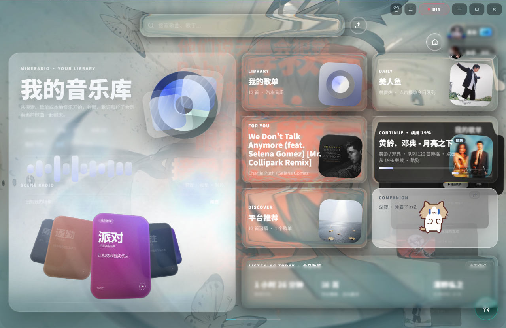
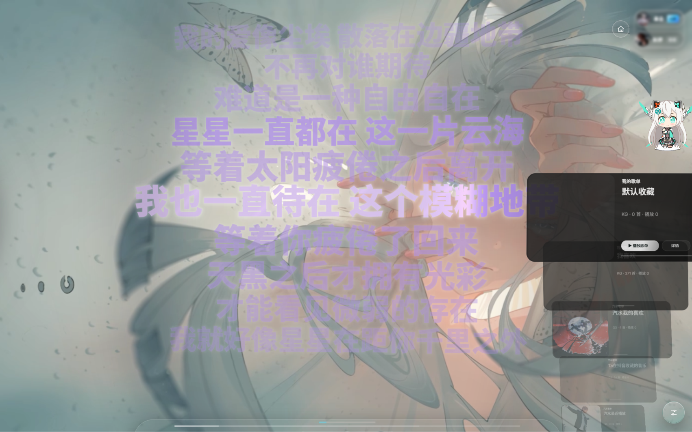

# Mineradio Vision

**Windows 桌面沉浸式音乐播放器** —— 把五个音乐平台的曲库、可编程的歌词舞台和一整套实时视觉特效装进同一个窗口。




## 这是什么

一个可以直接当主力用的本地音乐播放器：曲库来自五个平台，也可以是你自己的音乐文件夹；画面由歌词驱动，13 套歌词舞台模式 + 6 种动态背景随意切换；从播放、切歌、收藏到长时间听歌的每一处都做过手感打磨。

它不依赖任何在线账号也能用 —— 本地音乐库和内置歌单完全离线。

## 亮点速览

| 方向 | 做到了什么 |
| --- | --- |
| **五源合流** | 网易云 / QQ 音乐 / 酷狗 / 汽水 / Spotify 统一登录、搜索、歌单与播放，一个队列里混着放 |
| **歌词舞台** | 13 套可视化歌词样式，每套独立镜头与入场编排；逐行 / 逐字、双语、自定义配色与字体 |
| **视觉系统** | LiquidGlass 液态玻璃、Sonic Topography 音域地形、红心粒子、雪窗与鸟群收藏演出、天气雨滴 |
| **播放质感** | 原生 C++ BPM 分析、WASAPI 旁路输出、cuefield 自动混音、Gapless 无缝交接、四组曲线过渡 |
| **本地优先** | 本地音乐库（内嵌标签 / 封面 / 歌词自动读取）、内置歌单库、歌词与封面磁盘缓存 |
| **工程与安全** | 200+ 前端模块、三层懒加载、DPAPI 凭据加密、Host 白名单 + token 门禁、崩溃诊断与风暴退避 |

## 音乐源与账号

### 五个平台

| 平台 | 登录 | 主要能力 |
| --- | --- | --- |
| **网易云音乐** | 扫码 / 手机号 | 搜索、歌单、每日推荐、平台推荐面板、歌词 |
| **QQ 音乐** | QQ 扫码 | 搜索、歌单、播放；授权失效自动检测与静默续期 |
| **酷狗音乐** | 扫码 | 搜索、云歌单（含歌曲顺序）、VIP 状态同步、KRC 加密歌词解密与翻译歌词 |
| **汽水音乐** | 扫码 + 二次验证 | 设备身份持久化、本地会话导入、音频解密播放 |
| **Spotify** | OAuth | 搜索与播放、令牌自动刷新与限流恢复 |

- **统一账号面板**：五个平台的登录状态、UID 与会员信息集中管理，已登录平台显示账号卡片，切换平台不需要来回找入口。
- **同曲换源**：遇到灰歌自动寻找可播的同录音版本；底栏曲名牌的源徽章可以手动切到另一个平台。
- **登录包跨设备同步**：导出登录包或扫码互传，换机器不用五个平台重新登一遍。
- **凭据加密落盘**：所有 cookie / token 经 Windows DPAPI 加密后才写用户数据目录，仓库内不含任何账号信息。

## 歌词舞台

- **13 套歌词样式**：静止、流光、云阶、倾诉、回环、群唱、心象、浮名、莫奈、时计、镜台、凝彩、绘光。每套有自己的镜头运动、构图与进出场编排，不是同一个模板换皮。
- **节目编排层**：凝彩（tempera）按语义把整首歌切成段落，121 种镜头 / 3 种转场 / 5 种装饰母题，拖动进度条也能精确定位。
- **6 种动态背景 + 无背景**：sora / latent / monet / noise-texture / nomand / 自定义图片，可调漂移、模糊、饱和度与去色。
- **WebGL 实时玻璃**：桌面歌词与壁纸的背景玻璃走 WebGL 渲染，实例停用时自动镜像回退到 CSS 层，不会突然发灰；系统开启「减少透明度」时自动降级。
- **逐行 / 逐字**：行层与字层两套渲染路径，配色由统一的调色入口推导，换主题不串色。
- **双语与翻译**：原文 + 翻译双行显示，翻译本地启发式对齐。
- **桌面歌词**：独立窗口，保持软件内一致的质感，支持锁定穿透与白底可读性优化。
- **加密歌词解密**：酷狗 KRC（XOR + zlib）在本地解密后送入同一条歌词管道。

## 视觉与氛围

- **LiquidGlass 液态玻璃**：卡片级折射质感，实时采样壁纸与页面内容，带 P95 帧时间自适应降级；开放插件 SDK，插件默认 pending，需显式启用才求值。
- **Sonic Topography 音域回响**：频谱驱动的声学地形，随低频起伏。
- **红心动效**：纸片楔形扇、油墨灌满、冲击波粒子、极简星芒四套 + 随机。
- **收藏演出**：雪窗（落雪贴玻璃化开）与鸟群（170 只椋鸟收拢成形再惊散）两种整屏场景。
- **轨道过渡引擎**：混音 / 渐进 / 无缝 / 立体声转场四组配方，配合 Gapless 交接 —— 提前解析下一首并用隐藏音源静音预热，全程只有一个音源发声。
- **开屏加载**：玻璃墨珠 + 彗尾 + 涟漪的真实进度，按「真实就绪 + 时间门禁」推进，缓存命中也不会瞬间满格。
- **氛围与桌面整合**：天气雨滴粒子、3D 歌单架、电影镜头、粒子舞台、Wallpaper Engine 集成、完整桌面模式。
- **像素伙伴**：Home 桌宠卡片，可上传照片像素化成自己的伙伴；MediaPipe 手势缩放。

## 播放与音质

- **原生 C++ BPM 分析**（`native/mineradio-bpm`）：节拍与能量分析加速，缺模块时自动回落纯 JS。
- **WASAPI 旁路输出**：绕过系统混音，直达声卡。
- **cuefield 自动混音**：v2 引擎（19 模块）按调性、能量与段落决定过渡点，v1 兜底；弱证据时按分数门限决定是否生效。
- **音效链**：WebAudio EQ / 压缩 / 限幅，情绪与节奏驱动的参数化处理。
- **推荐与电台**：每日推荐、场景电台、平台推荐中心、平台推荐面板。
- **播放兜底**：取流失败逐级降级到同曲换源，无可用源时直接给出可见原因，不做无限重试。

## 本地优先

- **本地音乐库**：导入本机 MP3 / FLAC / WAV 等文件，自动读取内嵌标签、封面与歌词（含 GB18030 等编码），重启后保留；封面与歌词按需读取，全程不经过任何平台。
- **内置歌单库**：本机持久化的歌单，可同时收藏五个平台与本地歌曲，支持新建、重命名、删除、拖动排序，数据只存在本机。
- **缓存**：歌词磁盘缓存与下一首预取、封面缓存、节奏分析缓存，按容量上限自动回收。

## 工程与安全

- **模块化前端**：200 余个按领域划分的模块（01-scene ~ 12-folia），由 `index-loader.js` 并行加载。
- **三层懒加载**：主进程重模块首次 IPC 才加载，服务端音源模块首次调用才 require，前端分 boot 必需波与延迟波注入。
- **fail-open 兜底**：合并求值链里任何顶层异常都不会拖死后面的模块（WebGL 不可用时仍能进主界面并标记降级）。
- **服务端拆分**：`server.js` 与四个平台 API 全部按「配置身份 → 请求签名 → 资源映射 → 业务编排」四层拆成独立模块，路由与逻辑分离。
- **本地服务加固**：只监听 `127.0.0.1`、Host 头白名单防 DNS rebinding、CORS 只回显自身 origin、所有 `/api/*` 走 token 门禁且常量时间比较、错误信息不外泄。
- **崩溃可诊断**：Crashpad 接管原生崩溃，渲染主线程 OOM 单独识别，崩溃风暴自动退避。
- **安装器**：优先安装到 D–Z 盘、目录占用保护、卸载只清理自己的文件；未做代码签名，SmartScreen 会提示「未知发布者」。
- **测试**：`tests/` 下 99 个用例覆盖守卫、协议与回归，含针对重名遮蔽、启动失败、歌词交接的静态检查。

## 界面预览



## 下载安装

- **Windows 安装包（推荐）**：[Mineradio-3.3.2-Setup.exe](https://github.com/moli-lihuashi/Mineradio-Vision/releases/download/v3.3.2/Mineradio-3.3.2-Setup.exe)
- **免安装便携版**：[Mineradio-Vision-v3.3.2-portable-win-x64.zip](https://github.com/moli-lihuashi/Mineradio-Vision/releases/download/v3.3.2/Mineradio-Vision-v3.3.2-portable-win-x64.zip) —— 解压后运行 `Mineradio\Mineradio.exe`
- 全部版本与更新说明：[Releases](https://github.com/moli-lihuashi/Mineradio-Vision/releases)

> 安装包未做代码签名，Windows SmartScreen 可能提示「未知发布者」：点「更多信息 → 仍要运行」即可安装。

## 从源码运行

```bash
npm install
npm start
```

桌面版由 Electron 主进程启动本地服务（`server.js`）并加载界面，token 由主进程自动生成并拼在导航地址上，用不着手动处理。

### 只想用浏览器看（网页模式）

不启动 Electron，直接跑本地服务：

```bash
node server.js
```

启动日志会打印**可以直接打开的完整地址**：

```
======================================================
 粒子音乐可视化 v2  →  http://localhost:3000
 浏览器打开  →  http://localhost:3000/index.html?token=3f2a9c……（每次启动随机）
 登录态: 未登录
======================================================
```

**裸开 `http://localhost:3000` 一定 403，这是设计行为，不是服务坏了。** 首页响应会把 API token 明文注入 HTML，如果谁都能先拿到首页，就等于谁都能白拿 token 去调全部接口；所以 `/` 与 `/index.html` 对不带 token 的请求一律回 `403 {"error":"UNAUTHORIZED"}`。真正的入口是日志里那条 `?token=` 的地址。

**想把 token 固定下来**（方便收藏地址，或用脚本调接口）：

```bash
MINERADIO_API_TOKEN=my-local-token node server.js      # macOS / Linux / Git Bash
```

```powershell
$env:MINERADIO_API_TOKEN='my-local-token'; node server.js   # PowerShell
```

之后地址固定为 `http://127.0.0.1:3000/index.html?token=my-local-token`。

| 环境变量 | 默认 | 作用 |
| --- | --- | --- |
| `PORT` | `3000` | 监听端口 |
| `HOST` | `127.0.0.1` | 监听地址，建议只留环回 |
| `MINERADIO_API_TOKEN` | 每次启动随机 | 固定 API token |
| `MINERADIO_ALLOW_NON_LOOPBACK_HOST` | 未设置 | 设为 `1` 才接受非环回 Host 头（局域网访问） |

手工调 `/api/*` 时要在请求头带 `x-mineradio-token: <token>`；页面里的请求会自动带上，不需要额外配置。音频与封面这类由 `<audio>` / `` 直接发起的请求允许把 token 放在 query 里。

## 构建 Windows 安装包

```bash
npm run build:win
```

产物在 `dist/`，为 NSIS 安装包。国内网络拉 Electron 依赖较慢时可用镜像：

```powershell
$env:ELECTRON_MIRROR='https://npmmirror.com/mirrors/electron/'
$env:ELECTRON_BUILDER_BINARIES_MIRROR='https://npmmirror.com/mirrors/electron-builder-binaries/'
npm run build:win
```

## 更新机制

应用启动后请求 GitHub Releases 检查版本，远端版本高于本地时在应用内展示更新内容并下载安装包。

## 数据与隐私

登录凭据（DPAPI 加密）、搜索历史、自定义封面与歌词、本地音乐库索引、内置歌单、节奏分析缓存等全部只写本机用户数据目录或浏览器本地存储，**仓库内不含任何账号凭据、用户标识或音乐文件**。详见 [PRIVACY.md](./PRIVACY.md)。

## 免责声明

本项目仅供学习、交流和技术研究，不提供绕过付费、绕过会员、破解音质或重新分发音乐内容的能力。请遵守各音乐平台的用户协议、版权规则与会员权益规则，以及当地法律法规。使用本项目产生的一切后果由使用者自行承担。

本项目不是网易云音乐、QQ 音乐、酷狗音乐、汽水音乐、Spotify 或任何音乐平台的官方客户端，也不隶属于任何音乐平台；第三方平台名称与商标归其权利人所有。

## 致谢

感谢 [XxHuberrr](https://github.com/XxHuberrr) 开源的 Mineradio 项目，为本项目打下了基础。也感谢 Folia 可视化、morphicons、claude-pet 等开源作者的分享 —— 他们的工作让这个播放器能做到现在这样。

## 许可证

GPL-3.0，详见 [LICENSE](./LICENSE) 与 [NOTICE.md](./NOTICE.md)。修改内容记录在 [MODIFICATIONS.md](./MODIFICATIONS.md)，版本变更见 [CHANGELOG.md](./CHANGELOG.md)。

## Contributors

| Contributor | Role |
| --- | --- |
| [**moli-lihuashi**](https://github.com/moli-lihuashi) | 架构重构、多音乐源接入、视觉系统与功能开发 |
| **GLM**（智谱 AI） | AI 结对开发助手，参与代码实现、问题修复与文档编写 |
