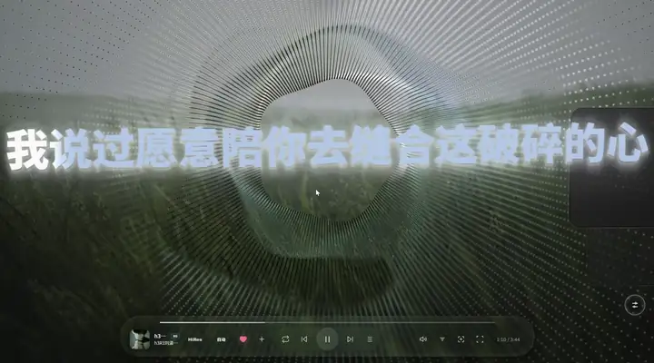
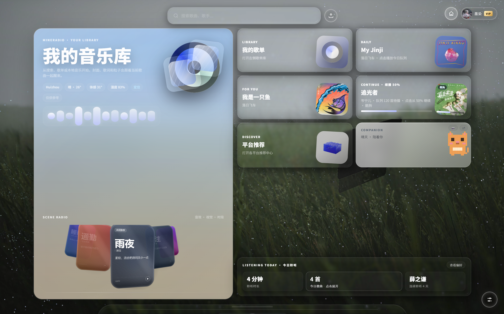

# Mineradio Vision

**Windows 桌面沉浸式音乐播放器** —— 电影镜头、粒子视觉、歌词舞台、3D 歌单架；接入**网易云音乐 / QQ 音乐 / 酷狗音乐 / 汽水音乐 / Spotify** 五个平台，支持账号登录、歌单同步、桌面歌词与酷狗 KRC 加密歌词解密。




*上面是歌词舞台的实际运行画面；完整 1 分 34 秒使用示例：[▶ 播放 / 下载](./docs/media/usage-demo-2026-10-12.mp4)*

## 为什么会有这个版本

Mineradio Vision 基于开源项目 [XxHuberrr/Mineradio](https://github.com/XxHuberrr/Mineradio) 二次开发，**仅供学习交流使用**。原作者已将仓库改名为 [Mineradio-paused](https://github.com/XxHuberrr/Mineradio-paused) 并停止更新，本仓库在停止维护的上游基础上继续开发：保留其歌词舞台、粒子视觉、电影镜头与 3D 歌单架，同时做了大规模架构重构与功能扩展。

| 对比项 | 上游 Mineradio | Mineradio Vision（本仓库） |
| --- | --- | --- |
| 维护状态 | 2026-09-21 起停更，仓库改名 `Mineradio-paused` | 持续维护中，最近更新 2026-10-16 |
| 音乐平台 | 上游原有接入能力 | 网易云 / QQ / **酷狗** / 汽水 / **Spotify** 五源统一登录、歌单同步与账号状态 |
| 酷狗链路 | — | KRC 加密歌词解密（krc1 XOR + zlib）、翻译歌词显示修复、云歌单 dfid 设备身份修复、歌单顺序同步、VIP 状态同步 |
| QQ 登录 | 授权失效需重新登录 | Cookie 失效自动判定 + 服务端静默续期，失败才提示重登 |
| 视觉系统 | 歌词舞台 / 粒子 / 电影镜头 / 3D 歌单架 | 追加 LiquidGlass 液态玻璃、Sonic Topography 音域回响、独立桌面歌词窗口、天气雨滴、像素伙伴桌宠 |
| 性能工程 | — | 原生 C++ BPM 分析加速、前端延迟波懒加载启动、按 P95 帧时间自适应降级 |
| 细节体验 | — | 久听休息提醒（连续聆听计时 + 整屏休息提示）、开屏真实加载进度 |

## 下载安装

- **Windows 安装包（推荐）**：[Mineradio-3.0.1-Setup.exe](https://github.com/moli-lihuashi/Mineradio-Vision/releases/download/v3.0.1/Mineradio-3.0.1-Setup.exe) —— 2026-10-16 构建，包含本仓库最新代码
- 免安装便携版：[Mineradio-Vision-v3.0.1-portable-win-x64.zip](https://github.com/moli-lihuashi/Mineradio-Vision/releases/download/v3.0.1/Mineradio-Vision-v3.0.1-portable-win-x64.zip)（2026-08-29 构建）
- 全部版本与更新说明：[Releases](https://github.com/moli-lihuashi/Mineradio-Vision/releases)

## 界面预览



## 声明

- 本项目基于 [XxHuberrr/Mineradio](https://github.com/XxHuberrr/Mineradio) 修改，原项目采用 GPL-3.0 开源协议，本修改版同样以 GPL-3.0 发布，并保留原项目的 `LICENSE`、`NOTICE.md` 等协议声明文件。
- 本项目**不代表原作者官方版本**，也不冒充原项目发布。感谢原作者 [XxHuberrr](https://github.com/XxHuberrr) 的开源贡献。
- 本项目**仅供学习、研究和技术交流使用**，请勿用于商业用途。
- 本项目不是网易云音乐、QQ 音乐、酷狗音乐、汽水音乐、Spotify 或任何音乐平台的官方客户端，也不隶属于任何音乐平台。第三方平台名称和商标归其权利人所有。

## 本版本的主要增强

相比原项目当前版本（v2.1.0），本修改版的主要优势与扩展：

### 音乐源与账号

- **QQ Cookie 失效检测 + 自动续期**（原项目 issue 高频反馈、未解决）：授权失效自动判定（code 1000 / login_required 等），服务端静默续期写回凭证，失败标记需重登；桌面端采集跳过过期项，避免旧 Cookie 污染会话。
- **酷狗链路深度修复与增强**：KRC 加密歌词解密（krc1 XOR + zlib）、翻译歌词显示修复、云歌单 dfid 设备身份修复（20017）、歌单同步含歌曲顺序、VIP 状态同步、cookie 会话管理。
- **汽水音乐设备身份持久化**：device_id 跨进程稳定，行为更接近真实客户端，降低风控触发。
- **多账号状态统一**：网易云 / QQ / 酷狗 / 汽水 / Spotify 五源登录入口统一，已登录平台显示账号卡片、UID 与会员状态，支持跨设备登录包导出 / 导入。
- **同曲换源与自动兜底**：灰歌自动寻找可播同录音版本，底栏曲名牌源徽章弹出切换器手动切源。
- **Spotify 接入增强**：OAuth 登录、搜索与播放，令牌自动刷新与限流恢复。

### 视觉系统

- **LiquidGlass 液态玻璃系统**：卡片级玻璃折射质感，壁纸 + 页面内容实时采样，自适应性能监测（P95 帧时间降级），并开放插件 SDK 与示例插件。
- **Sonic Topography 音域回响预设**：歌曲频谱驱动的声学地形视觉。
- **桌面歌词**：保持软件内歌词质感的独立桌面歌词窗口，支持锁定穿透与白底可读性优化。
- **天气雨滴视觉**：天气氛围驱动的雨滴粒子效果。
- **开屏加载进度**：真实加载进度条（玻璃墨珠 + 彗尾 + 涟漪完成动画），按「真实就绪 + 时间门禁」缓动推进，避免缓存命中时瞬间满格。
- **Home 布局升级**：首页 Hero 网格与卡片体系重设计，信息层级与视觉节奏更清晰。
- **卡片宠物「像素伙伴」**：Home 桌宠卡片，支持上传照片像素化为自定义专属伙伴（基于 [Lew1sWong/claude-pet](https://github.com/Lew1sWong/claude-pet) MIT 许可集成）。
- **玻璃控件体系**：FX / 登录滑动玻璃选中胶囊、音量玻璃滑块，按下放大、松开弹簧缩回的质感交互。
- **morphicons 图标形变动画**：播放 / 暂停、播放顺序、音量档位图标平滑形变切换（[guillermolg00/morphicons](https://github.com/guillermolg00/morphicons) MIT 许可）。
- **登录页单页布局**：「平台 → 方式 → 操作」流程化设计，多平台统一登录管理。
- 继承原项目 v2.1.0 的歌词舞台、粒子舞台、电影镜头、3D 歌单架、Wallpaper Engine 集成、完整桌面模式等核心视觉体验。

### 架构与工程

- **模块化架构重构**：单文件 `index.html` 巨石拆分为 69 个按领域划分的模块（01-scene ~ 10-shell），`index-loader.js` 并行 fetch 加载。
- **三层懒加载架构**：主进程重模块（Wallpaper Engine、Spotify、汽水本地会话）首次 IPC 按需加载，服务端音源模块首次调用才 require，前端模块分两波注入（boot 必需 + 延迟波），显著加快冷启动。
- **原生 C++ BPM 分析模块**：`native/mineradio-bpm` 提供节拍 / 能量分析加速（可选，带纯 JS 回退）。
- **DPAPI 凭据加密**：登录 cookie 通过 Windows DPAPI 加密存储在用户数据目录，仓库内不含任何账号信息。
- **安全安装器**：安装路径优先 D-Z 盘、专用目录占用保护、卸载仅清理已知 Mineradio 文件。
- **歌词磁盘缓存**：桌面版本地 lyric cache 与下一首预取。
- 本地内容指纹去重、歌词翻译本地启发式对齐、场景电台 2.0、情绪节奏音效大师（WebAudio EQ / 压缩 / 限幅）等创新 MVP。

## 从源码运行

```bash
npm install
npm start
```

桌面版入口由 Electron 主进程加载本地服务（`server.js`）。

## 构建 Windows 安装包

```bash
npm run build:win
```

产物位于 `dist/`，为 NSIS 安装包。国内网络下载 Electron 依赖较慢时可使用镜像：

```powershell
$env:ELECTRON_MIRROR='https://npmmirror.com/mirrors/electron/'
$env:ELECTRON_BUILDER_BINARIES_MIRROR='https://npmmirror.com/mirrors/electron-builder-binaries/'
npm run build:win
```

## 更新机制

应用会请求 GitHub Releases 检测新版本，远端版本高于本地版本时在应用内展示 Release 内容并下载安装包。

## 修改说明

详细的接口与功能改动清单见 [MODIFICATIONS.md](./MODIFICATIONS.md)。

## 用户数据与隐私

登录 Cookie、搜索历史、自定义封面、自定义歌词、节奏分析缓存等数据只保存在本机用户数据目录或浏览器本地存储中，不包含在仓库内。更多说明见 [PRIVACY.md](./PRIVACY.md)。

## 免责声明

本项目仅供学习、交流和技术研究，不提供绕过付费、绕过会员、破解音质或重新分发音乐内容的能力。请遵守对应音乐平台的用户协议、版权规则和会员权益规则，以及当地法律法规。使用者因使用本项目产生的一切后果由使用者自行承担。

## 版权与授权

原项目 Copyright (C) XxHuberrr，本项目继续采用 GPL-3.0 授权，详见 [LICENSE](./LICENSE) 与 [NOTICE.md](./NOTICE.md)。

MR Logo、Mineradio 名称、界面视觉设计与原创视觉表达归原作者所有；第三方依赖和第三方服务分别遵循其各自授权与服务条款。

## Contributors

| Contributor | Role |
| --- | --- |
| [**moli-lihuashi**](https://github.com/moli-lihuashi) | 架构重构、多音乐源接入、视觉系统与功能开发 |
| **GLM**（智谱 AI） | AI 结对开发助手，参与代码实现、问题修复与文档编写 |
