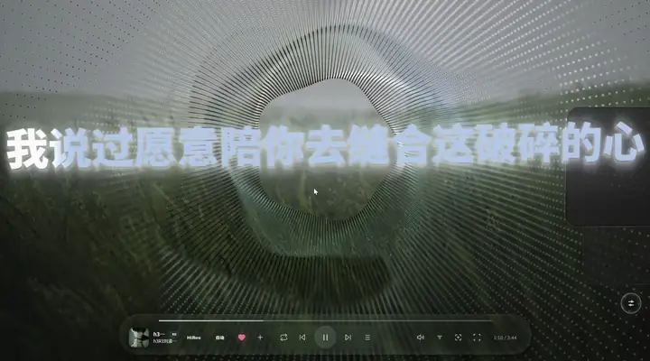
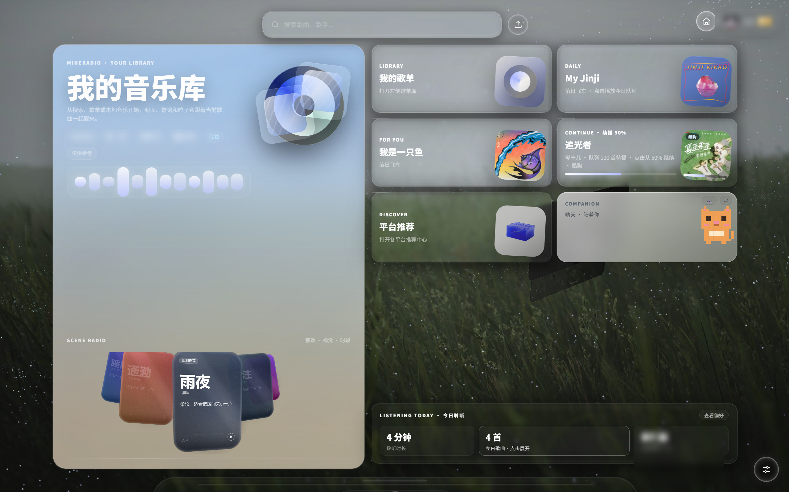

# Mineradio Vision

**Windows 桌面沉浸式音乐播放器** —— 电影镜头、粒子视觉、歌词舞台、3D 歌单架；接入**网易云音乐 / QQ 音乐 / 酷狗音乐 / 汽水音乐 / Spotify** 五个平台，支持账号登录、歌单同步、桌面歌词与酷狗 KRC 加密歌词解密。




*上面是歌词舞台的实际运行画面；完整 1 分 34 秒使用示例：[▶ 播放 / 下载](./docs/media/usage-demo-2026-10-12.mp4)*

## 为什么会有这个版本

Mineradio Vision 基于开源项目 [XxHuberrr/Mineradio](https://github.com/XxHuberrr/Mineradio) 二次开发，**仅供学习交流使用**。原作者已将仓库改名为 [Mineradio-paused](https://github.com/XxHuberrr/Mineradio-paused)，README 写明「长期停更」。本仓库在该项目基础上继续维护，并陆续把上游后续版本的部分实现同步回来 —— 例如汽水扫码登录 v6 与上游是同一份代码（原实现无法正常播放音乐，因此合并上游实现）。

### 我们的优势

- **持续维护**：五源接入（网易云 / QQ / 酷狗 / 汽水 / Spotify），支持账号登录、歌单同步与桌面歌词。
- **酷狗链路深度修复**：KRC 加密歌词解密、翻译歌词修复、云歌单 dfid 设备身份修复、VIP 状态同步。
- **QQ Cookie 自动续期**：授权失效自动检测（code 1000 / login_required 等）并静默续期写回。
- **视觉系统**：LiquidGlass 液态玻璃、Folia 歌词样式与 WebGL 玻璃、Sonic 音域回响预设、红心粒子场景、轨道过渡引擎、天气雨滴、桌面歌词、卡片宠物等。
- **性能与工程**：前端延迟波懒加载、原生 C++ BPM 分析、WASAPI 旁路输出、三层懒加载架构、崩溃诊断与风暴退避。
- **cuefield 过渡引擎**：v1 兜底 + v2 默认引擎共 38 个模块，automix 听感更强。
- **自动化测试**：按本仓库模块结构编写。

### 上游没有的功能

- 酷狗 KRC 加密歌词解密（XOR + zlib）
- QQ Cookie 自动续期（`QQConnectLogin`）
- LiquidGlass 液态玻璃
- 原生 C++ BPM 分析
- WASAPI 旁路输出
- 前端延迟波懒加载
- 久听休息提醒
- 登录包跨设备同步（导出 / 扫码互传）
- 崩溃诊断 / 崩溃风暴退避

## 下载安装

- **Windows 安装包（推荐）**：[Mineradio-3.3.0-Setup.exe](https://github.com/moli-lihuashi/Mineradio-Vision/releases/download/v3.3.0/Mineradio-3.3.0-Setup.exe) —— 2026-10-19 构建，包含本地音乐库 / 内置歌单库与最新修复
- 免安装便携版：[Mineradio-Vision-v3.3.0-portable-win-x64.zip](https://github.com/moli-lihuashi/Mineradio-Vision/releases/download/v3.3.0/Mineradio-Vision-v3.3.0-portable-win-x64.zip) —— 2026-10-19 构建，解压后运行 `Mineradio\Mineradio.exe`
- 全部版本与更新说明：[Releases](https://github.com/moli-lihuashi/Mineradio-Vision/releases)

> 安装包未做代码签名，Windows SmartScreen 可能提示「未知发布者」：点「更多信息 → 仍要运行」即可正常安装。安装路径优先 D–Z 盘，卸载只清理本程序自己的文件。

## 界面预览



## 声明

- 本项目基于 [XxHuberrr/Mineradio](https://github.com/XxHuberrr/Mineradio) 修改，原项目采用 GPL-3.0 开源协议，本修改版同样以 GPL-3.0 发布，并保留原项目的 `LICENSE`、`NOTICE.md` 等协议声明文件。
- 本项目**不代表原作者官方版本**，也不冒充原项目发布。感谢原作者 [XxHuberrr](https://github.com/XxHuberrr) 的开源贡献。
- 本项目**仅供学习、研究和技术交流使用**，请勿用于商业用途。
- 本项目不是网易云音乐、QQ 音乐、酷狗音乐、汽水音乐、Spotify 或任何音乐平台的官方客户端，也不隶属于任何音乐平台。第三方平台名称和商标归其权利人所有。

## 本版本的主要增强

本版本相对上游的主要增强：

### 音乐源与账号

- **QQ Cookie 失效检测 + 自动续期**（原项目 issue 高频反馈、未解决）：授权失效自动判定（code 1000 / login_required 等），服务端静默续期写回凭证，失败标记需重登；桌面端采集跳过过期项，避免旧 Cookie 污染会话。
- **酷狗链路深度修复与增强**：KRC 加密歌词解密（krc1 XOR + zlib）、翻译歌词显示修复、云歌单 dfid 设备身份修复（20017）、歌单同步含歌曲顺序、VIP 状态同步、cookie 会话管理。
- **汽水音乐设备身份持久化**：device_id 跨进程稳定，行为更接近真实客户端，降低风控触发。
- **多账号状态统一**：网易云 / QQ / 酷狗 / 汽水 / Spotify 五源登录入口统一，已登录平台显示账号卡片、UID 与会员状态，支持跨设备登录包导出 / 导入。
- **同曲换源与自动兜底**：灰歌自动寻找可播同录音版本，底栏曲名牌源徽章弹出切换器手动切源。
- **Spotify 接入增强**：OAuth 登录、搜索与播放，令牌自动刷新与限流恢复。
- **本地音乐库**：导入本机音频文件（MP3 / FLAC / WAV 等），自动读取内嵌标签、封面与歌词（含 GB18030 等编码）；导入的曲目重启后保留，播放走 `mineradio-local://` 本地协议，封面与歌词按需读取，不经过任何平台。上次听到一半的本地歌曲会在启动时自动恢复。
- **内置歌单库**：本机持久化的「Mineradio 内置歌单」，可同时收藏五个平台与本地歌曲，不依赖任何平台登录；歌单面板点「+ 新建内置」创建，支持重命名、删除、拖动排序，数据只存在本机。

### 视觉系统

- **LiquidGlass 液态玻璃系统**：卡片级玻璃折射质感，壁纸 + 页面内容实时采样，自适应性能监测（P95 帧时间降级），并开放插件 SDK 与示例插件。
- **Sonic Topography 音域回响预设**：歌曲频谱驱动的声学地形视觉。
- **桌面歌词**：保持软件内歌词质感的独立桌面歌词窗口，支持锁定穿透与白底可读性优化。
- **天气雨滴视觉**：天气氛围驱动的雨滴粒子效果。
- **开屏加载进度**：真实加载进度条（玻璃墨珠 + 彗尾 + 涟漪完成动画），按「真实就绪 + 时间门禁」缓动推进，避免缓存命中时瞬间满格。
- **Home 布局升级**：首页 Hero 网格与卡片体系重设计，信息层级与视觉节奏更清晰。
- **卡片宠物「像素伙伴」**：Home 桌宠卡片，支持上传照片像素化为自定义专属伙伴（基于 [Lew1sWong/claude-pet](https://github.com/Lew1sWong/claude-pet) MIT 许可集成）。
- **玻璃控件体系**：FX / 登录滑动玻璃选中胶囊、音量玻璃滑块，按下放大、松开弹簧缩回的质感交互。
- **morphicons 图标形变动画**：播放 / 暂停、播放顺序、音量档位图标平滑形变切换（[guillermolg00/morphicons](https://github.com/guillermolg00/morphicons) MIT 许可）。
- **登录页单页布局**：「平台 → 方式 → 操作」流程化设计，多平台统一登录管理。
- 继承上游的歌词舞台、粒子舞台、电影镜头、3D 歌单架、Wallpaper Engine 集成、完整桌面模式等核心视觉体验。

### 架构与工程

- **模块化架构重构**：单文件 `index.html` 巨石拆分为 69 个按领域划分的模块（01-scene ~ 10-shell），`index-loader.js` 并行 fetch 加载。
- **合并求值链的 fail-open 兜底**：125 个模块合并成**单个** script 求值（保留跨文件函数提升），代价是顶层任何未捕获异常都会带走其后全部模块。为此 `new THREE.WebGLRenderer` 已改为 try/catch + 惰性渲染器桩（WebGL 不可用时仍能进主界面，`body.mineradio-no-webgl` 标记降级），开屏计时起点与点击进入也不再依赖模块后段的初始化是否执行过。
- **三层懒加载架构**：主进程重模块（Wallpaper Engine、Spotify、汽水本地会话）首次 IPC 按需加载，服务端音源模块首次调用才 require，前端模块分两波注入（boot 必需 + 延迟波），显著加快冷启动。
- **原生 C++ BPM 分析模块**：`native/mineradio-bpm` 提供节拍 / 能量分析加速（可选，带纯 JS 回退）。
- **DPAPI 凭据加密**：登录 cookie 通过 Windows DPAPI 加密存储在用户数据目录，仓库内不含任何账号信息。
- **安全安装器**：安装路径优先 D-Z 盘、专用目录占用保护、卸载仅清理已知 Mineradio 文件。
- **歌词磁盘缓存**：桌面版本地 lyric cache 与下一首预取。
- 本地内容指纹去重、歌词翻译本地启发式对齐、场景电台 2.0、情绪节奏音效大师（WebAudio EQ / 压缩 / 限幅）等创新 MVP。

## 从源码运行

```bash
npm install
npm start
```

桌面版入口由 Electron 主进程加载本地服务（`server.js`）。

## 构建 Windows 安装包

```bash
npm run build:win
```

产物位于 `dist/`，为 NSIS 安装包。国内网络下载 Electron 依赖较慢时可使用镜像：

```powershell
$env:ELECTRON_MIRROR='https://npmmirror.com/mirrors/electron/'
$env:ELECTRON_BUILDER_BINARIES_MIRROR='https://npmmirror.com/mirrors/electron-builder-binaries/'
npm run build:win
```

## 更新机制

应用会请求 GitHub Releases 检测新版本，远端版本高于本地版本时在应用内展示 Release 内容并下载安装包。

## 修改说明

详细的接口与功能改动清单见 [MODIFICATIONS.md](./MODIFICATIONS.md)。

## 用户数据与隐私

登录 Cookie、搜索历史、自定义封面、自定义歌词、节奏分析缓存等数据只保存在本机用户数据目录或浏览器本地存储中，不包含在仓库内。本地音乐库的曲目索引、封面缓存与内置歌单同样只写本机用户数据目录，仓库内不含任何音乐文件。更多说明见 [PRIVACY.md](./PRIVACY.md)。

## 免责声明

本项目仅供学习、交流和技术研究，不提供绕过付费、绕过会员、破解音质或重新分发音乐内容的能力。请遵守对应音乐平台的用户协议、版权规则和会员权益规则，以及当地法律法规。使用者因使用本项目产生的一切后果由使用者自行承担。

## 版权与授权

原项目 Copyright (C) XxHuberrr，本项目继续采用 GPL-3.0 授权，详见 [LICENSE](./LICENSE) 与 [NOTICE.md](./NOTICE.md)。

MR Logo、Mineradio 名称、界面视觉设计与原创视觉表达归原作者所有；第三方依赖和第三方服务分别遵循其各自授权与服务条款。

## Contributors

| Contributor | Role |
| --- | --- |
| [**moli-lihuashi**](https://github.com/moli-lihuashi) | 架构重构、多音乐源接入、视觉系统与功能开发 |
| **GLM**（智谱 AI） | AI 结对开发助手，参与代码实现、问题修复与文档编写 |
